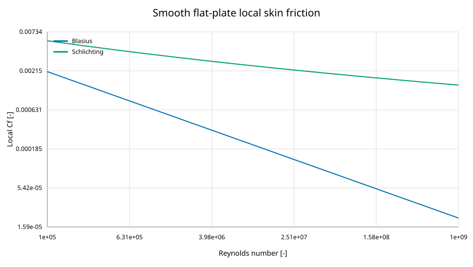
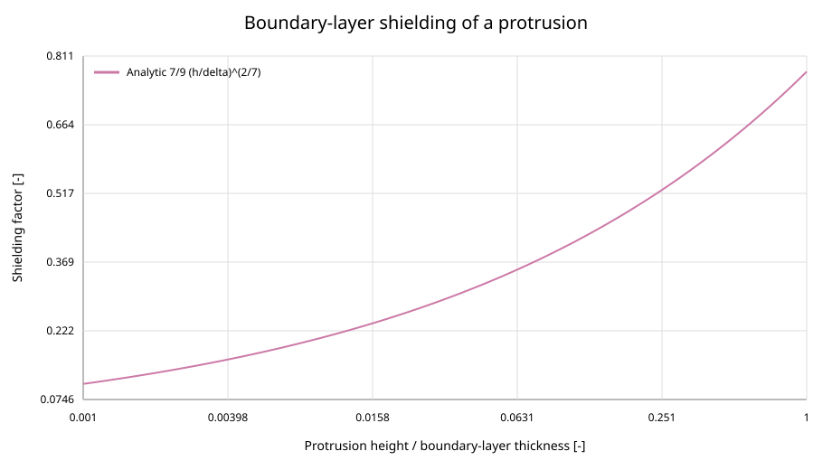

Viscous-flow verification
=========================

Scope and method
----------------

This record covers smooth flat-plate boundary-layer correlations, Eckert and
Van Driest II compressibility paths, Van Driest and Volpiani velocity-profile
transformations, the Spalding--Coles composite profile, GRA/Walz temperature
closures, and boundary-layer-immersed protrusion integration.

The Blasius and Schlichting friction results, and the retained one-fifth-power
turbulent thickness results, are compared with a
fixed CSV independently evaluated from their published equations over Reynolds
numbers ``1e5`` through ``1e9``.  NACA TN-3811 and NASA TN D-6945 are the
primary chart references for Van Driest II.  Three representative points from
NASA TN D-6945 Figure 3(e) are digitized at ``Re_x=1e6``, ``T_e=222 K``, and
``T_w/T_aw=0.6``.  Their pointwise absolute tolerance records line thickness,
the smallest readable chart increment, and scan-reading uncertainty.  Exact
equation and limit checks remain the tighter implementation tests.

Results
-------

.. include:: ../_generated/viscous_flow_validation.rst

Marching laminar boundary layer
-------------------------------

``marching_boundary_layer`` is compared with solutions that do not share its
numerics. The wedge and heat-transfer references solve the similarity equations
with SciPy's ``solve_bvp``, and the published rows are NACA Report 1293, Table II
(:ref:`Cohen and Reshotko, 1956 <ref-cohen-reshotko-1956>`), where
``S_w = g_w - 1`` without dissipation. The Howarth reference ``x_sep/L = 0.1199``
is Hartree's ``x_s = 0.9589`` for ``U = 1 - x/8`` (:ref:`Hartree, 1939
<ref-hartree-1939>`). The plate reference is the compressible similarity
solution of ``flat_plate_boundary_layer``. The compressible Howarth case maps
the linearly retarded flow through the Illingworth--Stewartson transformation,
which is exact for ``C = Pr = 1`` and an adiabatic wall, so it must separate at
the same transformed position as the incompressible flow. The wall-temperature
row raises the wall by 100 K over 1 cm and compares the heat flux at the end of
that change with a march through 160 extra stations inside it, on the same
interpolated wall temperature. The integral balances
use only the solver's own output and need no reference.

.. include:: ../_generated/marching_laminar_verification.rst

Interpretation and model validation boundary
--------------------------------------------

Skin friction decreases with Reynolds number in both smooth-plate
friction correlations.  The constant-property Van Driest transform reduces to the
ordinary wall variables, and Van Driest II approaches its dedicated
incompressible correlation as Mach tends to zero.  For a constant-width
protrusion in a one-seventh-power velocity profile, direct integration gives
``7/9 (h/delta)^(2/7)`` while the protrusion remains inside the boundary layer.

These checks verify that the empirical equations and numerical integrals were
implemented as stated.  They do not establish that an empirical correlation
is accurate for every roughness, pressure gradient, wall-temperature ratio,
or three-dimensional protrusion.  In particular, protrusion ``C_D`` is an
input rather than a correlation supplied by this package.

The commands that regenerate this record are listed in the repository's
``DEVELOPMENT.md``.

Marching SA-noft2 boundary layer
--------------------------------

The frozen constant-edge SA solver checks implementation consistency across
18 cases. It shares the turbulence model, so this is not independent physical
validation. The :ref:`NASA TMR bump <ref-tmr-bump-sa>` compares against external
CFL3D and FUN3D RANS solutions. Wall Cp supplies the edge pressure, which limits
the comparison on the curved wall. SI units, downstream wall arc length,
local-edge Cf, and positive-into-wall heat flux are used by the API; only the
TMR table converts wall shear to freestream dynamic-pressure normalization.

.. include:: ../_generated/marching_sa_verification.rst

The development memo records momentum and enthalpy balances, streamwise and
wall-normal refinement, separation, and fallback checks. Energy balance improves
with wall-normal refinement rather than streamwise refinement. SA-noft2 develops
its own laminar start and transition near the leading edge; this is not a
transition prediction. Accuracy against experiment is not established.
Agreement with CFD that uses the same model does not establish it.

Thin axisymmetric marching boundary layer
------------------------------------------

The model uses SI, downstream wall arc length from a sharp tip/leading edge,
wall-normal outward y, local-edge Cf, positive-into-wall heat flux and positive
beta for acceleration. Perfect-gas and isentropic-edge assumptions apply.
Transverse/longitudinal curvature and normal pressure gradients are excluded.
The delta99/r_w warning at 0.1 is an uncalibrated indicator, expected near tips.

All 57 saved planar arrays are bit-identical with omitted or explicit None
radius. Constant-radius cylinders reproduce planar wall quantities and profiles
within relative 1e-9 (profiles use a relative maximum norm because no-slip
values approach zero). Laminar cones at M0.3 and M2, 5 and 20 degrees, with
a prescribed 300 K or adiabatic wall, reproduce the sqrt(3) relation within 6e-12 percent.
The Mangler original was not obtained; the analytical transform and
:ref:`Tauber <ref-tauber-1989>`, :ref:`Seiff <ref-seiff-1954>` and
:ref:`Moore <ref-moore-1951>` provide the checks.

Generalized Mangler mappings on 801 nodes differ by at most 0.000827 percent
in Cf. SA has no such exact mapping. Momentum balance medians are below
0.05 percent; enthalpy diagnostics distinguish streamwise and wall-normal
refinement. All details, including adiabatic diagnostics and synthetic shoulder
stress measurements, are in section 12 of the development design note.

The real-body example uses :ref:`R&M 3633 <ref-winter-rotta-smith-1968>`
wind-tunnel measurements. See :ref:`the guide <rm3633-example>` for geometry,
interpolation, thermal and transition assumptions. Maximum Cf discrepancy
is 0.0004443 and delta99/r_w reaches 0.4774. Physical accuracy, transition and
real shoulder edge conditions remain open. The regression bound is distinct
from the +/-0.0002 measurement accuracy.

.. include:: ../_generated/marching_axisymmetric_verification.rst
